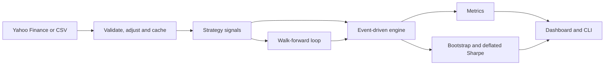

# TradStrat

[](https://github.com/Elarionitis/TradStrat/actions/workflows/ci.yml)

[](LICENSE)

**An event-driven backtester that tries to prove your strategy wrong.**

Most backtesters tell you how much a strategy would have made. TradStrat also asks whether you should
believe it. It tunes strategies without hindsight using walk-forward validation, puts confidence intervals
on the results, and corrects for how many configurations you tried.


## What It Found

I ran 5 classic strategies on 6 ETFs from 2007 to 2025, with parameters tuned only on past data and
realistic trading costs. [Full results](docs/RESULTS.md).

| Measure | Result |
| --- | --- |
| Mean Sharpe ratio, in-sample | 0.86 |
| Mean Sharpe ratio, out-of-sample | **0.31** |
| Mean Sharpe ratio, buy and hold | 0.60 |
| Runs with a higher Sharpe than buy and hold | 1 of 30 |
| Runs with a higher CAGR than buy and hold | 0 of 30 |
| Runs with a shallower max drawdown than buy and hold | 20 of 30 |
| Full-sample winners significant against zero | 7 of 30 |
| Full-sample winners significant against buy and hold | **0 of 30** |

The strategies reduced drawdowns, but none showed reliable evidence of beating buy and hold. Performance
fell by about two thirds once parameters had to be chosen in advance.

The last two rows show why the choice of benchmark matters. On ten years of SPY, the best moving-average
crossover gets a deflated Sharpe of 98.4% against zero, which looks like a discovery. Against buy and hold
it gets 2.5%. A long-only strategy clears the first bar just by owning a rising market. To reproduce this:

```bash
tradstrat optimize --ticker SPY --strategy ma_crossover --start 2016-11-07 --end 2026-11-06 --points 6
```


## Features

**Simulation**
- Event-driven engine that fills each signal at the next bar's open, so no decision can use its own price
- Commission, slippage and whole-share position sizing
- Stop-losses that fill at the open when the market gaps through them
- Volatility-targeted sizing
- A benchmark that runs through the same simulator and pays the same costs
- Dividend-adjusted prices, so returns are total returns

**Validation**
- Walk-forward optimization, in sliding or anchored mode
- Deflated Sharpe ratio, against zero and against the benchmark
- Probabilistic Sharpe ratio
- Block bootstrap confidence intervals, plus the probability of beating the benchmark

**Strategies**
- Moving average crossover, z-score mean reversion, RSI reversal, Donchian breakout, time-series momentum
- A registry that gives any new strategy the dashboard, CLI and optimizer with no extra code

**Interfaces**
- A Streamlit dashboard and a command-line interface, both over the same library

## Quick Start

You need Python 3.11 or newer.

```bash
git clone https://github.com/Elarionitis/TradStrat.git
cd TradStrat
python -m venv .venv
source .venv/bin/activate
pip install -e ".[dev]"
```

Start the dashboard:

```bash
streamlit run app.py
```

Or use the command line:

```bash
tradstrat list
tradstrat backtest --ticker SPY --strategy rsi --param window=10
tradstrat optimize --ticker SPY --strategy ma_crossover --points 6
tradstrat walk-forward --ticker QQQ --strategy donchian --train-bars 756 --test-bars 252
```

If Yahoo Finance is unavailable, use `--sample` or choose **Synthetic sample** in the dashboard. That
dataset is simulated, so results on it say nothing about real markets.

## How It Works



On each bar the engine does three things, in the order a live system would:

1. At the open, it acts on the signal formed at the previous close.
2. During the bar, it checks any stop order against the low.
3. At the close, it marks the position to market.

Walk-forward validation chooses parameters on one window and trades them on the next, then rolls forward.
Joining those unseen windows gives an equity curve built only from decisions that could have been made at
the time.


The formulas and design decisions are in [docs/METHODOLOGY.md](docs/METHODOLOGY.md).

## How It Is Tested

A backtester that is subtly wrong is worse than none, because it produces confident, wrong numbers. So the
tests target the mistakes that matter most:

- **Look-ahead bias:** a property-based test runs on every registered strategy and asserts that signals
  computed on a truncated history match the full-history signals exactly. Other tests rewrite a bar's high,
  low and close and assert that what was bought at its open does not change.
- **Train/test leakage:** tests rewrite a fold's test window, and everything after it, and assert that the
  parameters chosen for that fold do not change.
- **Accounting:** for arbitrary prices and signals, trade P&L must reconcile exactly with the change in
  equity, and cash must never go negative.
- **Published results:** the deflated Sharpe code reproduces the numerical example in Bailey and
  Lopez de Prado (2014), and bootstrap intervals are checked for coverage against known values.
- **The tests themselves:** `scripts/mutation_check.py` injects 20 realistic bugs and confirms that the
  suite catches each one.

```bash
pytest --cov                       # Tests with coverage
python scripts/mutation_check.py   # Confirm the tests can fail
ruff check . && mypy               # Lint and type checks
```

The suite blocks network access, so it never depends on Yahoo being available.

## Add a Strategy

Write one class. The dashboard, CLI and optimizer pick it up from its declared parameters.

```python
@register
@dataclass(frozen=True)
class MyStrategy(Strategy):
    window: int = 20

    key: ClassVar[str] = "my_strategy"
    label: ClassVar[str] = "My Strategy"
    description: ClassVar[str] = "Long while the close is above its moving average."
    params: ClassVar[tuple[ParamSpec, ...]] = (
        ParamSpec("window", "Window", 20, 5, 100, 5, "Bars in the moving average."),
    )

    @property
    def warmup(self) -> int:
        return self.window

    def generate_signals(self, data: pd.DataFrame) -> pd.DataFrame:
        average = data["Close"].rolling(self.window).mean()
        return pd.DataFrame({"signal": (data["Close"] > average).astype(int)}, index=data.index)
```

The look-ahead tests then cover it automatically.

## Project Structure

```text
app.py                    Streamlit dashboard
tradstrat/
    data.py               Loading, validation, dividend adjustment and caching
    strategies.py         Strategy base class, registry and implementations
    engine.py             Event-driven simulator
    metrics.py            Return, risk and trade statistics
    stats.py              Deflated Sharpe ratio and block bootstrap
    validation.py         Parameter search and walk-forward validation
    reporting.py          Display formatting
    charts.py             Plotly figures
    cli.py                Command-line interface
scripts/
    run_research.py       Reproduces docs/RESULTS.md
    mutation_check.py     Injects bugs to confirm the tests catch them
    make_sample_data.py   Generates the synthetic dataset
tests/                    Unit, property-based and end-to-end tests
```

## Limitations

- **One asset at a time.** There is no portfolio construction across assets.
- **Long or flat only.** There is no short selling or leverage.
- **Daily bars.** Intraday ordering is unknown, so stops are checked against the bar's low.
- **Simple cost model.** Costs are a fixed percentage, with no market impact, spread dynamics or partial fills.
- **Idle cash earns nothing.** This handicaps strategies that spend time out of the market.
- **Yahoo Finance data.** It is free and convenient but not point-in-time, and it excludes delisted securities.
- **Small study.** Six assets and five strategy families are not enough to generalize about markets.

## References

- Bailey, D. and Lopez de Prado, M. (2012). The Sharpe Ratio Efficient Frontier. *Journal of Risk*.
- Bailey, D. and Lopez de Prado, M. (2014). The Deflated Sharpe Ratio. *Journal of Portfolio Management*.
- Pardo, R. (2008). *The Evaluation and Optimization of Trading Strategies*. Wiley.

## Disclaimer

This project is for research and education. It is not investment advice.
