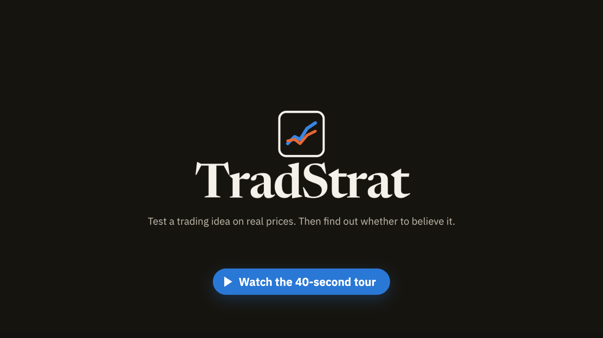
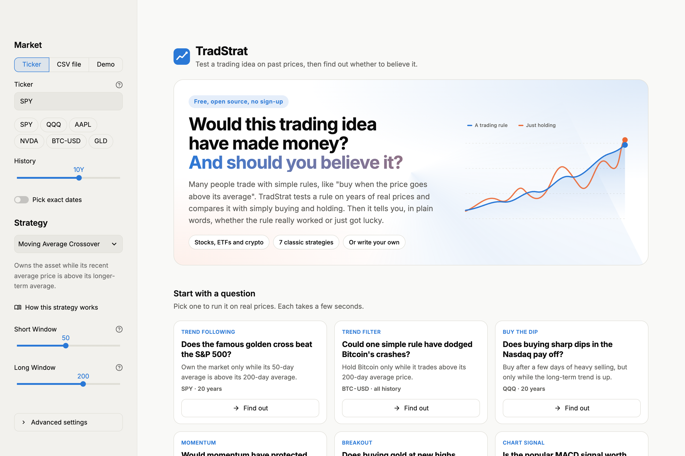
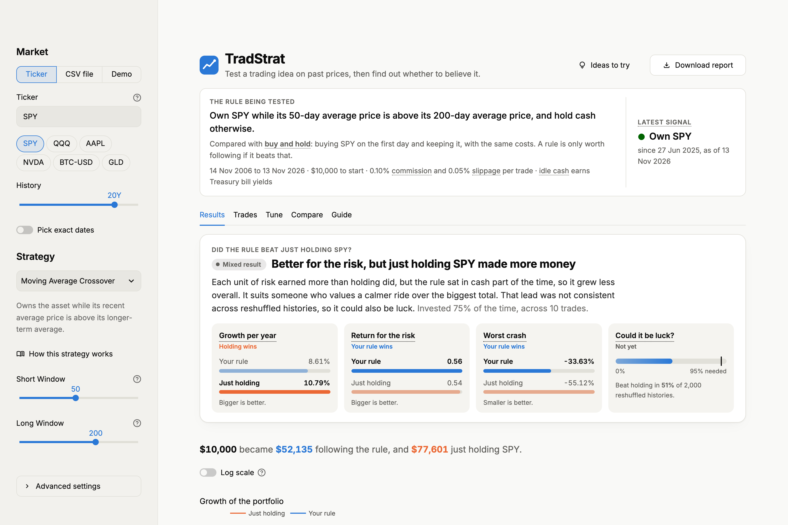
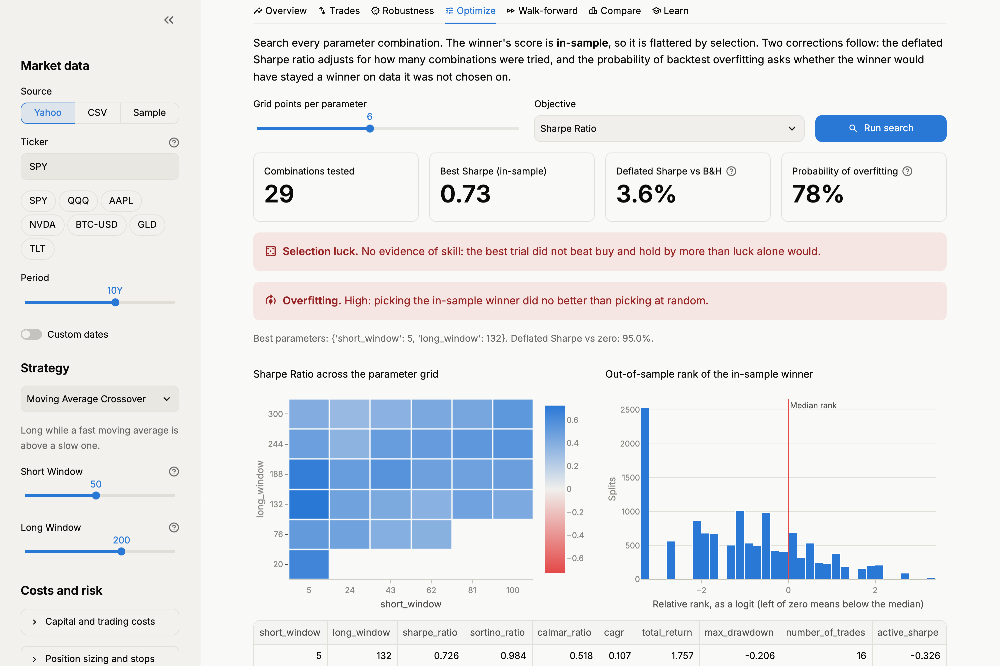
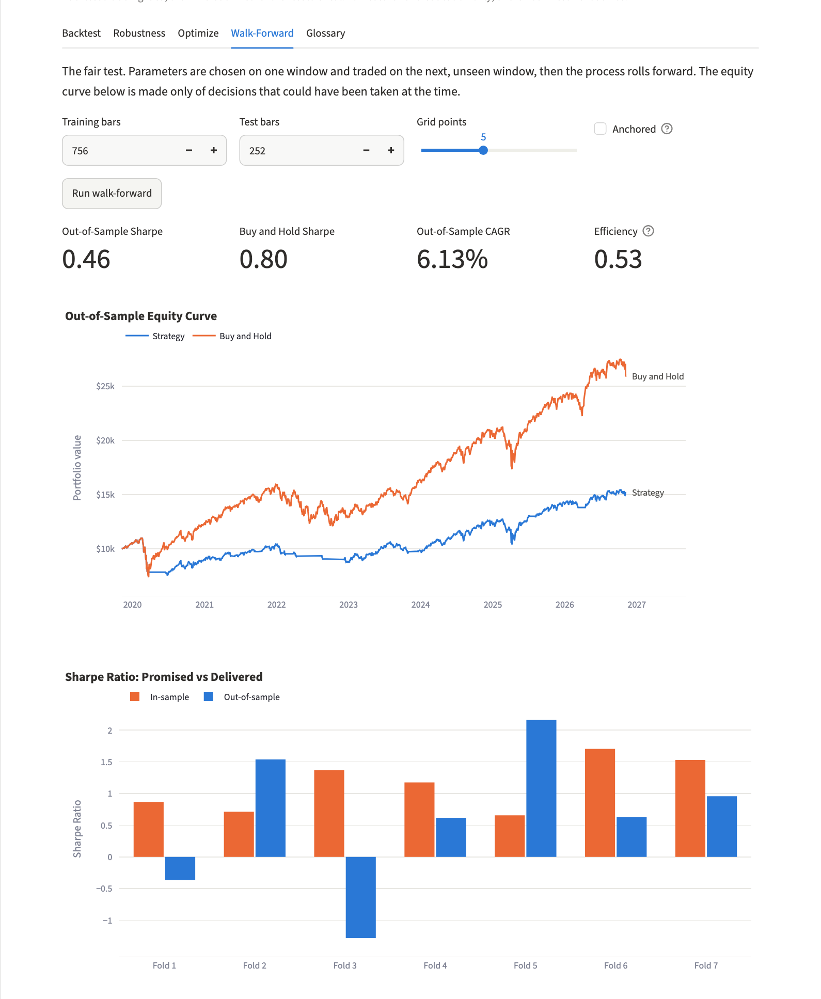
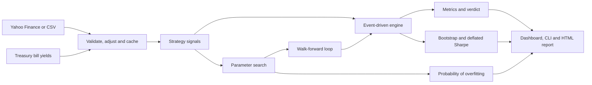

<div align="center">


# TradStrat

**Backtest a trading idea, then find out whether to believe it.**

[](https://github.com/Elarionitis/TradStrat/actions/workflows/ci.yml)


[](LICENSE)

<p><a href="https://tradstrat.streamlit.app"><strong>Try it live: tradstrat.streamlit.app</strong></a></p>

</div>

**What it is.** A free website that tests a trading rule, such as *"buy when the price goes above its
200-day average"*, on years of real prices. It compares the rule with simply buying and holding, and tells
you in plain words whether the rule really worked or just got lucky.

**Why I built it.** Most trading ideas look great on a chart and then lose real money, usually because of
hidden trading costs, hindsight, or plain luck. Most backtesting tools only tell you how much a rule would
have made. TradStrat also checks whether that number can be trusted, and explains the answer so that someone
with no finance background can follow it.

**Who it is for.** Anyone curious about whether a trading idea holds up, from first-time investors to
people who build trading strategies.

<a href="assets/tradstrat-tour.mp4"></a>

<picture>
  <source media="(prefers-color-scheme: dark)" srcset="docs/images/landing_dark.png">
  
</picture>

Pick a question, or set up your own test, and the answer comes back as a head-to-head with simply holding:

<picture>
  <source media="(prefers-color-scheme: dark)" srcset="docs/images/dashboard_dark.png">
  
</picture>

## What You Can Do With It

- **Test any Yahoo Finance symbol or your own data.** Stocks, ETFs, indices, crypto, or any CSV export from a
  broker or exchange.
- **Test your own idea, without code.** Write a rule such as `rsi(2) < 10 and close > sma(200)` and it gets
  the same checks as the built-in strategies, including tuning and walk-forward validation.
- **Get a straight answer.** Every backtest opens with a verdict such as *"Beat just holding SPY, but it could
  be luck"*, and the reasons behind it.
- **See what the rule says today.** Whether it would own the asset or hold cash at the latest close, and since
  when.
- **Start from a question.** Six ready-made tests, such as whether a simple trend rule dodged Bitcoin's
  crashes, run on real prices in one click.
- **Start without a finance background.** The dashboard states the rule being tested in one sentence, explains
  every strategy in plain English, and defines each piece of jargon when you hover over it.
- **See how fragile a result is.** Bootstrap intervals, the probabilistic and deflated Sharpe ratios, and the
  probability of backtest overfitting.
- **Tune without fooling yourself.** Walk-forward validation only ever trades parameters chosen on the past.
- **Share it.** The address bar always links to the exact test on screen, and a self-contained HTML report
  holds the interactive charts and the full trade log.

## Quick Start

You need Python 3.11 or newer.

```bash
git clone https://github.com/Elarionitis/TradStrat.git
cd TradStrat
python -m venv .venv
source .venv/bin/activate
pip install -e .
```

Open the dashboard:

```bash
streamlit run app.py
```

Or use the command line:

```bash
tradstrat backtest --ticker SPY --strategy rsi --cash-rate tbill
tradstrat backtest --ticker BTC-USD --buy "close > high(252)" --sell "close < low(50)"
tradstrat report --ticker QQQ --strategy donchian --out reports/qqq.html
tradstrat compare --ticker GLD
tradstrat optimize --ticker SPY --strategy ma_crossover --points 6
tradstrat walk-forward --ticker IWM --strategy momentum --train-bars 756 --test-bars 252
tradstrat list
```

If Yahoo Finance is unavailable, use `--sample` or pick **Demo** in the dashboard. That dataset is
simulated, so results on it say nothing about real markets.

## Put It Online

**Streamlit Community Cloud (free).** Sign in at [share.streamlit.io](https://share.streamlit.io) with
GitHub, choose this repository, set the main file to `app.py` and Python to 3.12, and deploy. It installs
`requirements.txt` and reads the settings in `.streamlit/config.toml`.

**Any host that runs containers**, such as Render, Fly.io or Google Cloud Run:

```bash
docker build -t tradstrat .
docker run -p 8501:8501 tradstrat
```

The image runs as a non-root user, listens on `$PORT` when the host sets one, and reports its health at
`/_stcore/health`. Public servers share one address for every visitor's requests to Yahoo Finance, so heavy
use can hit Yahoo's rate limits. The dashboard then says so in plain words and offers the demo data, and
every download is cached for an hour.

## What It Found

I ran seven classic strategies on six ETFs from 2007 to 2025. Parameters were tuned only on past data, trades
paid commission and slippage, and idle cash earned Treasury bill yields. [Full results](docs/RESULTS.md).

| Measure | Result |
| --- | --- |
| Mean Sharpe ratio, in-sample | 0.73 |
| Mean Sharpe ratio, out-of-sample | **0.20** |
| Mean Sharpe ratio, buy and hold | 0.52 |
| Runs with a higher Sharpe than buy and hold | 1 of 42 |
| Runs with a higher CAGR than buy and hold | 1 of 42 |
| Runs with a shallower max drawdown than buy and hold | 33 of 42 |
| Full-sample winners significant against zero | 8 of 42 |
| Full-sample winners significant against buy and hold | **0 of 42** |
| Mean probability of backtest overfitting | 42% |

The strategies cut drawdowns, but none showed reliable evidence of beating buy and hold. Risk-adjusted
performance fell by about three quarters once parameters had to be chosen in advance. The one run that beat
buy and hold on both Sharpe and CAGR was a moving average crossover on long Treasuries, with a Sharpe ratio of
0.21 against 0.16.

The two strategies added in 2.1 make the point from opposite ends. The 200-day trend filter, with a single
setting to tune, kept the most of its backtest (a mean Sharpe of 0.51 in-sample and 0.30 out of sample) and
cut the worst crash on all six assets. MACD, with three settings, fell from 0.53 to -0.01: the more knobs a
rule has, the more of its backtest is fitted noise.

The benchmark you test against matters as much as the statistics. On ten years of SPY, the best moving
average crossover gets a deflated Sharpe ratio of 95.3% against cash, which looks like a discovery. Against
buy and hold it gets 3.4%, and its probability of backtest overfitting is 77%. A long-only strategy clears
the first bar just by owning a rising market. To reproduce this:

```bash
tradstrat optimize --ticker SPY --strategy ma_crossover --start 2016-11-07 --end 2026-11-06 --points 6 --cash-rate tbill
```

The whole study is reproduced by `python scripts/run_research.py`.

## Features

**An honest simulation**
- Signals fill at the next bar's open, so no decision can use its own price
- Commission, slippage and whole-share sizing
- Fixed and trailing stop-losses that fill at the open when the market gaps through them
- Volatility-targeted position sizing
- Idle cash earns a fixed rate or the real 13-week Treasury bill yield
- Dividend-adjusted prices, so returns are total returns
- A buy-and-hold benchmark that runs through the same simulator and pays the same costs

**Tests of whether to believe it**
- A plain-English verdict against buy and hold
- Sharpe, Sortino, alpha and beta on returns above cash, so holding Treasury bills is never mistaken for skill
- Block bootstrap confidence intervals, and the chance of beating buy and hold
- Probabilistic and deflated Sharpe ratios, against zero and against the benchmark
- Probability of backtest overfitting, by combinatorially symmetric cross-validation
- Walk-forward optimization, in sliding or anchored mode

**Seven strategies, and your own**
- Moving average crossover, 200-day trend filter, MACD crossover, Donchian breakout, time-series momentum,
  z-score mean reversion and RSI reversal
- A small rule language for testing an idea without writing code, whose every number can be tuned
- A registry that gives a new strategy the dashboard, CLI, optimizer and look-ahead tests with no extra code

**Three ways to use it**
- A Streamlit dashboard with light and dark themes, a short welcome for first-time visitors, definitions
  on hover, and links that reopen the exact test
- A command-line interface
- Self-contained HTML reports

<table>
<tr>
<td width="50%"></td>
<td width="50%"></td>
</tr>
<tr>
<td align="center"><sub>Parameter search, with the probability that the winner was overfit</sub></td>
<td align="center"><sub>Walk-forward: what each fold's parameters promised, and what they delivered</sub></td>
</tr>
</table>

## Write Your Own Rule

Pick **Write your own rule** in the dashboard, or pass `--buy` and `--sell` on the command line. A rule
compares two things with `>`, `<`, `crosses above` or `crosses below`, and joins comparisons with `and` or `or`.

| Building block | Meaning |
| --- | --- |
| `close` | The closing price |
| `sma(50)`, `ema(20)` | Simple or exponential moving average of the close |
| `rsi(14)` | Wilder's Relative Strength Index, from 0 to 100 |
| `high(252)`, `low(20)` | Highest high or lowest low of the previous days, not counting today |
| `return(126)` | Percentage change over the period, so `return(126) > 0` means up over six months |
| `zscore(20)` | Distance from the average in standard deviations |

Some rules to start from:

| Idea | Buy when | Sell when |
| --- | --- | --- |
| Golden cross | `sma(50) crosses above sma(200)` | `sma(50) crosses below sma(200)` |
| Trend filter | `close > sma(200)` | empty: hold while the buy rule is true |
| Dip in an uptrend | `rsi(2) < 10 and close > sma(200)` | `rsi(2) > 70 or close < sma(200)` |
| 52-week high | `close > high(252)` | `close < low(50)` |

Every number in a rule becomes a parameter, so the optimizer and walk-forward validation tune a custom rule
exactly as they tune the built-in strategies. The same look-ahead tests cover rules, and the built-in
strategies written as rules produce identical positions.

## Where It Fits

Charting platforms such as TradingView and Python libraries such as backtesting.py and vectorbt are built to
run backtests quickly and at scale. Portfolio Visualizer is built around asset allocation. TradStrat is built
around one question those tools leave to you: is this result real? It compares every result with simply holding
the asset, and corrects for luck and for how many variations were tried. It also asks for no code and no
finance background.

## Use Your Own Data

Upload a CSV in the dashboard, or pass `--csv prices.csv` on the command line. TradStrat reads most exports
as they are:

- A date column called `Date`, `Datetime`, `Timestamp` or `Time`, as text or Unix seconds or milliseconds
- `Open`, `High`, `Low` and `Close` columns, in any capitalization
- Optional `Volume` and `Adj Close` columns. With an adjusted close, prices are adjusted for dividends.

```csv
date,open,high,low,close,volume
2024-01-02,187.15,188.44,183.89,185.64,82488700
2024-01-03,184.22,185.88,183.43,184.25,58414500
```

## How It Works



On each bar the engine does four things, in the order a live system would:

1. Before the open, it credits overnight interest on cash.
2. At the open, it acts on the signal formed at the previous close.
3. During the bar, it checks any stop order against the low.
4. At the close, it marks the position to market.

Walk-forward validation chooses parameters on one window and trades them on the next, then rolls forward.
Joining those unseen windows gives an equity curve built only from decisions that could have been made at
the time. The probability of backtest overfitting takes a different angle: it splits history into 16 blocks,
tries all 12,870 ways of using half of them to pick a winner, and counts how often that winner lands in the
bottom half on the other half.

The formulas and design decisions are in [docs/METHODOLOGY.md](docs/METHODOLOGY.md).

## How It Is Tested

A backtester that is subtly wrong is worse than none, because it produces confident, wrong numbers. So the
tests target the mistakes that matter most:

- **Look-ahead bias:** a property-based test runs on every registered strategy and example rule, and asserts
  that signals computed on a truncated history match the full-history signals exactly. Other tests rewrite a
  bar's high, low and close and assert that what was bought at its open, and where a trailing stop sat, do not
  change.
- **Train/test leakage:** tests rewrite a fold's test window, and everything after it, and assert that the
  parameters chosen for that fold do not change.
- **Accounting:** for arbitrary prices, signals, stops and cash rates, trade P&L plus interest must reconcile
  exactly with the change in equity, and cash must never go negative.
- **Published results:** the deflated Sharpe code reproduces the numerical example in Bailey and
  Lopez de Prado (2014). The overfitting estimate is checked against cases with known answers: about 50% for
  pure noise, and close to 0% for a configuration with a real edge.
- **The tests themselves:** `scripts/mutation_check.py` injects 33 realistic bugs and confirms that the
  suite catches each one.

```bash
pip install -e ".[dev]"
pytest --cov                       # Tests with coverage
python scripts/mutation_check.py   # Confirm the tests can fail
ruff check . && mypy               # Lint and type checks
```

The suite blocks network access, so it never depends on Yahoo being available.

## Add a Strategy

Write one class. The dashboard, CLI and optimizer pick it up from its declared parameters.

```python
@register
@dataclass(frozen=True)
class MyStrategy(Strategy):
    window: int = 20

    key: ClassVar[str] = "my_strategy"
    label: ClassVar[str] = "My Strategy"
    description: ClassVar[str] = "Long while the close is above its moving average."
    params: ClassVar[tuple[ParamSpec, ...]] = (
        ParamSpec("window", "Window", 20, 5, 100, 5, "Bars in the moving average."),
    )
    overlays: ClassVar[tuple[tuple[str, str], ...]] = (("average", "Moving average"),)

    @property
    def warmup(self) -> int:
        return self.window

    def generate_signals(self, data: pd.DataFrame) -> pd.DataFrame:
        average = data["Close"].rolling(self.window).mean()
        signal = (data["Close"] > average).astype(int)
        return pd.DataFrame({"signal": signal, "average": average}, index=data.index)
```

`overlays` is optional and draws the strategy's own indicator lines on the price chart. The dashboard
describes the strategy with its `description`, and the look-ahead tests cover it automatically. For a fuller
explanation in the dashboard, you can also add an entry to `GUIDES` in `tradstrat/guide.py`.

## Project Structure

```text
app.py                    Streamlit dashboard
assets/                   Logo and dashboard stylesheet
tradstrat/
    data.py               Loading, validation, dividend adjustment, cash rates and caching
    strategies.py         Strategy base class, registry and implementations
    rules.py              The rule language for custom strategies
    engine.py             Event-driven simulator
    metrics.py            Return, risk and trade statistics
    stats.py              Deflated Sharpe, block bootstrap and probability of overfitting
    validation.py         Parameter search, walk-forward validation and strategy comparison
    reporting.py          Display formatting and the plain-English verdicts
    guide.py              Plain-English explanations of the built-in strategies
    glossary.py           Definitions, and the helper that shows them on hover
    charts.py             Plotly figures for light and dark themes
    tearsheet.py          Self-contained HTML reports
    cli.py                Command-line interface
scripts/
    run_research.py       Reproduces docs/RESULTS.md
    mutation_check.py     Injects bugs to confirm the tests catch them
    make_sample_data.py   Generates the synthetic dataset
tests/                    Unit, property-based and end-to-end tests
```

## Limitations

- **One asset at a time.** There is no portfolio construction across assets.
- **Long or flat only.** There is no short selling or leverage.
- **Daily bars.** Intraday ordering is unknown, so stops are checked against the bar's low, and a trailing
  stop only moves up after a bar has closed.
- **Simple cost model.** Costs are a fixed percentage, with no market impact, spread dynamics or partial fills.
- **Yahoo Finance data.** It is free and convenient but not point-in-time, and it excludes delisted securities.
- **Small study.** Six assets and five strategy families are not enough to generalize about markets.

## References

- Bailey, D. and Lopez de Prado, M. (2012). The Sharpe Ratio Efficient Frontier. *Journal of Risk*.
- Bailey, D. and Lopez de Prado, M. (2014). The Deflated Sharpe Ratio. *Journal of Portfolio Management*.
- Bailey, D., Borwein, J., Lopez de Prado, M. and Zhu, Q. (2017). The Probability of Backtest Overfitting.
  *Journal of Computational Finance*.
- Pardo, R. (2008). *The Evaluation and Optimization of Trading Strategies*. Wiley.

## Contributing

Bug reports and pull requests are welcome. See [CONTRIBUTING.md](CONTRIBUTING.md) for the checks to run, and
[CHANGELOG.md](CHANGELOG.md) for what changed in each release.

## Disclaimer

TradStrat is for research and education. It is not investment advice, and past performance does not predict
future results.
